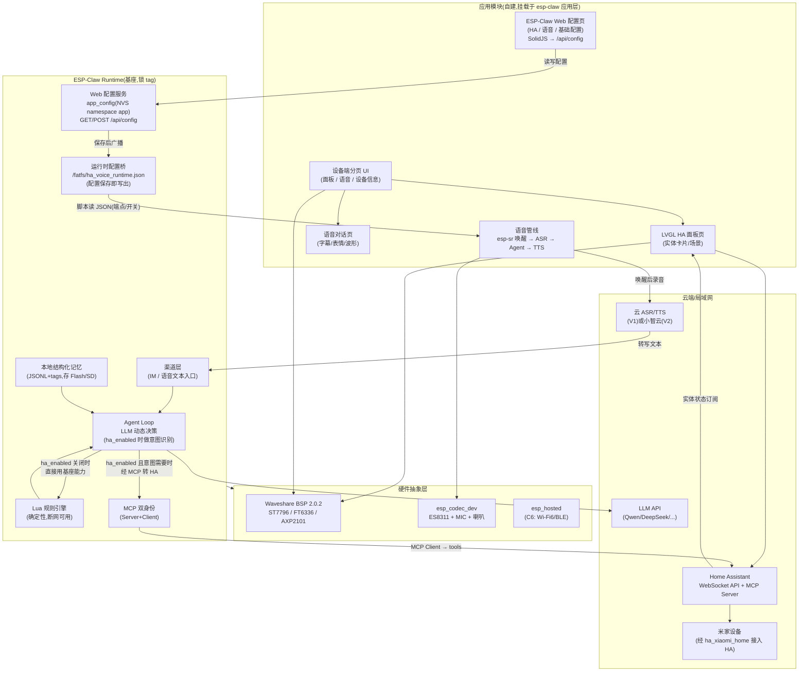

# ha_ai_panel — ESP32-P4 智能家居中控 + AI 语音助手

> **状态:方案已定(路线 B);M0 基座验证 ✅;M1 面板第一阶段 ✅(真机目视通过,待接真实 HA);语音 V1 第一阶段 ✅(PTT↔Agent 双向链路真机跑通);M2/M3/M4 代码已落地(ASR/TTS 真实调用、HA MCP 意图路由、离线本地联动、语音打断),待真机凭据联调。**
> 记录:[M0](docs/m0-verification.md) · [M1 面板](docs/m1-panel.md) · [语音集成](docs/voice-integration.md)。
> 目标硬件:Waveshare ESP32-P4-WIFI6-Touch-LCD-3.5(芯片版本 rev1.3,构建必须用 `rev1_3` 配置档)。

---

## 1. 目标与范围

### 1.1 目标与既定路线

**单固件,以 ESP-Claw(edge_agent)为唯一运行时基座**,在一块 P4 板上实现三个角色:

1. **触摸控制面板**:自研 LVGL 界面,直连 Home Assistant(下称 HA)WebSocket API,控制米家智能设备(米家设备由 HA 侧的米家集成接入)。
2. **AI 语音助手**:esp-sr 本地唤醒 + 云端 ASR/TTS 构建语音管线,接入 esp-claw 对话能力,支持多轮对话与语音打断(方案见 §6.2,M0/M3 分步验证)。
3. **AI 执行引擎**:esp-claw 的 Agent Loop 负责感知 → 决策 → 执行——通过 MCP 协议调用 HA 控制米家设备、用 Lua 确定性规则实现断网可用的本地自动化、维护本地结构化记忆。

分工一句话:**ESP-Claw 是唯一基座;LVGL 面板负责"点",自建语音管线负责"说",ESP-Claw Agent 负责"做"。**

> 路线决策记录:曾对比 A(xiaozhi 基座单固件)/ B(esp-claw 基座单固件)/ C(双固件分阶段)三条路线(理由见 §5),**最终选择 B**——接受语音体验需自建打磨的代价,换取单一框架、全功能一体的终态。

### 1.2 基座化开发原则(新增能力一律"长在 ESP-Claw 上")

HA 面板与语音助手都是**基于 ESP-Claw 架构与规范新增的扩展**,不另起配置/界面体系:

1. **配置项 → ESP-Claw 网页配置机制**:所有新增配置(HA 地址/令牌、HA 启用开关、语音唤醒开关、
   ASR/TTS 端点与密钥)统一走 ESP-Claw 的 Web 配置服务——C 侧在 `app_config`(NVS namespace
   `app`)声明字段并登记到 `http_server_config_api.c` 的 `CONFIG_FIELDS[]` 分组表,前端在
   SolidJS 配置页读写,GET/POST `/api/config`。不改 NVS 布局、不新增配置通道。
2. **功能交互 → ESP-Claw 设备端界面**:所有新增交互统一在 ESP-Claw 设备端 LVGL 界面上实现。
   M1 的面板已从"单屏"升级为**底部分页菜单**(面板 / 语音 / 设备信息),兼顾交互合理性与便捷性,
   而不是把信息堆在一屏。
3. **执行主体恒为 ESP-Claw Agent**:语音被唤醒后,动作**始终由 ESP-Claw Agent Loop 执行**。
   "是否启用 Home Assistant"是一个配置项(`ha_enabled`):**关闭**时 Agent 只用 ESP-Claw 自身能力
   直接处理;**启用**时由 LLM 做**意图识别**,仅在意图需要时才把请求经 MCP 转给 HA。

> 配置从网页到底层的**同源**路径:C 侧 `app_config`(NVS)→ `ha_panel.c` 的
> `ha_panel_publish_runtime_config()` 写出 `/fatfs/ha_voice_runtime.json` → Lua 语音脚本读取
> (与既有"屏幕桥"同向,复用 `/fatfs` 可写分区,无需新增 Lua↔C 绑定),保存即生效、无需重启。

### 1.3 非目标(明确不做)

- ❌ 设备直连米家云(协议私有、需企业资质,一律经 HA 中转)
- ❌ ESPHome 固件(对本板 SPI 屏支持不成熟,且与仓库 ESP-IDF 体系脱节)
- ❌ 以 xiaozhi-esp32 为基座或双固件并存(路线 A/C 已弃选;小智仅作协议参考与体验基准,见 §3)
- ❌ 摄像头功能(MIPI-CSI 接口本方案不用,留作后续扩展)
- ❌ HA 侧的安装与配置本身(文档只给对接所需的 HA 侧清单,见 §6.4)

### 1.4 前置条件

| 依赖 | 用途 | 备注 |
|---|---|---|
| Home Assistant 实例(≥2025.x) | 设备中转 + MCP Server | 需启用 MCP Server 集成与 WebSocket API |
| 小米账号 + HA 米家集成 | 米家设备接入 HA | 推荐 [XiaoMi/ha_xiaomi_home](https://github.com/XiaoMi/ha_xiaomi_home)(官方,OAuth 2.0);备选 [al-one/hass-xiaomi-miot](https://github.com/al-one/hass-xiaomi-miot) |
| HA 长期访问令牌 | 面板/Agent 鉴权 | HA 用户页生成 |
| LLM API Key(Qwen/DeepSeek/OpenAI/Claude 任一) | esp-claw 决策引擎 | 自编程(Chat Coding)需强工具调用模型,官方推荐 `qwen3.6-plus`/`deepseek-v4-pro` 级别 |
| 云 ASR/TTS 账号(方案 V1)或小智账号(方案 V2) | 语音链路 | 见 §6.2,M0/M3 数据决策后只留其一 |

---

## 2. 硬件资源盘点

| 资源 | 型号/规格 | 本方案用途 |
|---|---|---|
| 主控 | ESP32-P4NRW32,双核 RISC-V @400MHz,叠封 32MB PSRAM | 单固件三合一运行;32MB PSRAM 是 esp-sr + LVGL + Agent 三栈并存的内存底气 |
| Flash | 16MB Nor Flash | 固件 + esp-sr 声学模型 + Lua 脚本 + Agent 本地记忆(JSONL) |
| 无线 | ESP32-C6H8(SDIO 挂载) | Wi-Fi 6 + BLE 5,经 esp_hosted 驱动 |
| 显示 | 3.5" IPS 320×480,ST7796,SPI 接口 | LVGL 面板 UI + 语音对话 UI(字幕/表情) |
| 触摸 | FT6336 电容触摸,I2C | 面板交互 |
| 音频 | ES8311 编解码 + 板载贴片麦克风 + MX1.25 8Ω2W 喇叭座 | 唤醒拾音 / ASR 上行录音 / TTS 回复播放 |
| 电源 | AXP2101 PMIC + 3.7V 锂电池接口 | 电池供电形态可选 |
| 存储 | Micro SD(SDIO 3.0) | 可选:媒体资源、Agent 记忆备份 |
| 按键 | PWR / RST / BOOT | PWR(接 GPIO49,高有效)单击切换**待机/唤醒**(仅熄屏;语音唤起自动恢复运行,长按交给 PMIC 6s 关机不触发息屏);BOOT 可复用为"一键说话"(PTT 备用触发) |
| 其他 | MIPI-CSI、MIPI-DSI 预留、USB OTG 2.0 HS | 本方案不用;USB OTG 后续可接 HID |

---

## 3. 可复用的软件资产

| 组件 | 版本/来源 | 在本方案中的角色 | 验证状态 |
|---|---|---|---|
| **ESP-Claw** | `espressif/esp-claw`(锁 tag) | **固件唯一基座**:Agent Runtime(LLM+Lua+MCP+记忆)、Board Manager 声明式板级适配 | 支持 ESP32-P4 本地构建;有 `waveshare_esp32_p4_nano` 板级参照(同款 ES8311) |
| Waveshare BSP | `waveshare/esp32_p4_wifi6_touch_lcd_3_5 ==2.0.2`(组件注册表) | 屏/触摸/音频/电源的板级驱动 | 本仓库 11 号示例已验证 |
| esp_codec_dev | `espressif/esp_codec_dev ^1.5.4` | ES8311 录放音链路(esp-claw audio 设备 + esp-sr AFE 的公共底座) | 本仓库 06 号示例已验证 |
| esp-sr | `espressif/esp-sr` **master**(注册表已发布版尚不支持 IDF v6) | WakeNet 本地唤醒 + AFE(AEC/NS/VAD),P4 官方支持 | **M0 已验证可共存编译**(§7 注) |
| xiaozhi-esp32 | `78/xiaozhi-esp32` **v2.4.0**(官方支持本板) | ① 协议参考:小智 OPUS + WS/MQTT+UDP 协议栈可移植为语音方案 V2 的轻客户端;② 体验基准:M0 烧官方固件采集语音体验基线(非产品形态) | 官方固件可直接烧录 |
| HA MCP Server | HA ≥2025.x 内置集成 | esp-claw 以 MCP Client 身份控制 HA 实体(Streamable HTTP + Bearer 令牌) | 代码已就绪(M2),待 HA 实例真机对接 |
| esp_hosted | ESP-IDF 组件 | P4 ↔ C6 SDIO 通信 | BSP/Waveshare 示例已验证 |
| esp-bmgr-assist | `pip install esp-bmgr-assist`(0.8.3) | 提供 `idf.py bmgr`,由 YAML 生成板级配置 | M0 已使用 |
| revision_profiles | `config/revision_profiles.cmake`(本仓库) | rev1_3/rev3_x 构建档位 | 仓库机制,直接 include |

---

## 4. 总体架构(单固件)



要点:

- **基座化原则落地**:① 触摸/语音的**配置**统一在 ESP-Claw 的 Web 配置页(`WEBUI → CFG`,SolidJS → `/api/config`)完成;② 板载**交互**统一在设备端**分页 UI**(`UI`:面板 / 语音 / 设备信息)实现;③ 语音唤醒后的**执行主体恒为 ESP-Claw Agent**(`CHAN → LOOP`)。
- **触摸路径**:面板页 → HA WebSocket → HA 米家集成 → 米家设备(不经 AI)。
- **语音路径**:esp-sr 唤醒 → 录音 → 云 ASR 转文本 → 文本经渠道层进 Agent Loop → LLM 决策 → TTS 播放(详见 §6.2 的 V1/V2 子方案)。
- **执行路径**:事件(定时/传感器/IM/语音)→ Agent Loop → 命中 Lua 规则则本地直接执行(断网可用);`ha_enabled` **启用**且意图需要 Home Assistant 时,经 MCP Client 调 HA MCP Server → 米家设备;`ha_enabled` **关闭**时 Agent 只用 ESP-Claw 自身能力,不触达 HA。
- **配置桥路径**:Web 配置页保存 → `app_config` 写 NVS → `ha_panel.c` 写出 `/fatfs/ha_voice_runtime.json` → 语音脚本读取端点/开关。与既有"屏幕桥"同向,复用 `/fatfs`,保存即生效。
- **回传路径**:HA 实体状态经 WebSocket 订阅刷新面板;Agent 执行结果写记忆并反哺 LLM 上下文。

---

## 5. 架构路线决策记录

ESP-Claw 与小智都是**完整应用框架**(各自拥有 main、任务模型、板级抽象、NVS 布局)。曾对比三条路线:

| 路线 | 做法 | 结论 |
|---|---|---|
| A 单固件·xiaozhi 基座 | 以小智 v2.4.0 为基座,把 esp-claw 的 Agent Loop/Lua/MCP/记忆反向组件化嵌入 | **弃选**:esp-claw 的事件驱动 runtime + Lua 沙箱 + MCP 双身份反向塞进小智框架,合并手术比 B 更重;且小智项目非为组件化设计 |
| **B 单固件·esp-claw 基座(选定)** | 以 esp-claw edge_agent 为基座;语音管线自建(esp-sr + 云 ASR/TTS);面板 UI 自研挂载 | **选定**:单一框架、终态即全功能;代价是语音与 UI 全部自建,体验打磨量最大 |
| C 双固件分阶段 | 固件 1 = 小智官方;固件 2 = esp-claw + 面板 | **弃选**:风险最低但同一时刻只跑一个固件、切换需重烧,不符合"一块板全功能"的产品目标 |

### 路线 B 的关键判断

- **基座适配成本最低**:esp-claw 自带 Board Manager(YAML 声明式板级配置),仿 `waveshare_esp32_p4_nano`(同款 ES8311)写本板 YAML 即可跑通 Agent 核心。
- **最大缺口是语音**:esp-claw 交互以 IM 为主,语音非核心——唤醒、打断、多轮、延迟全部自建(§6.2 分两步验证)。
- **次大缺口是 UI**:esp-claw 参照板无屏,LVGL 面板页是在其应用层全新挂载的模块,需验证其应用结构与显示任务模型的兼容性(M1)。
- **风险敞口集中于单一上游**:esp-claw 未出稳定版,基座锁定 tag + 适配层隔离(§9 风险 1)。

---

## 6. 功能规格

### 6.1 HA 触摸面板

**配置一律走 ESP-Claw 网页**:HA 的启用开关、地址、令牌都在 ESP-Claw 的 Web 配置页维护(不新增本地设置页、不新增配置存储),通过 `GET/POST /api/config` 读写,落 `app_config`(NVS namespace `app`)。

| 功能 | 规格 |
|---|---|
| 启用开关 | Web 配置页 `ha` 组的 `ha_enabled`(true/false);**关闭**时整块「面板」分页隐藏(连同底部分页标签)、Agent 也不触达 HA |
| 连接配置 | Web 配置页填写 HA 地址(IP/域名,如 `homeassistant.local`)+ 长期访问令牌;存 NVS(app_config);支持 mDNS 发现;断线自动重连并在设备端 UI 提示 |
| 实体浏览 | 按 房间(area)/ 域(domain) 两级分组;拉取 `states` 与 `services` 列表 |
| 控制卡片 | switch / light(含亮度、色温)/ climate(含温度设定)/ cover / 传感器只读卡 |
| 场景 | scene 与 script 一键触发 |
| 状态刷新 | WebSocket 订阅 `state_changed` 事件,实时刷新;增量订阅、断线补拉 |
| 设备端界面 | 从"单屏"升级为**底部分页菜单**(**面板 / 语音 / 设备信息**),面板页与其他功能页解耦,交互更清晰 |
| 分页门控 | 分页按配置显隐:「面板」页随 `ha_enabled`、「语音」页随 `voice_enabled`(见 §6.2);关闭时对应分页与标签**直接隐藏**并自动切到首个可见页 |
| 设备信息页 | 展示 ESP-Claw **系统状态**分组卡片:网络(是否设置/是否连接/IP 地址)、LLM(是否设置/已设模型)、IM(是否设置/各渠道标记)、语音(唤醒/ASR/TTS);卡片多于屏幕时**垂直滚动**。面板页不再用 mock 实体,改为展示 HA 链接状态(是否已配置 + 地址) |

### 6.2 AI 语音(自建,分两步落地)

**共用底座**:esp-sr(WakeNet 唤醒 + AFE 回声消除/降噪/VAD)从 esp_codec_dev 读 ES8311 麦克风;TTS 经 ES8311 播放;BOOT 键作 PTT 备用触发。

| 子方案 | 链路 | 优点 | 缺点 |
|---|---|---|---|
| **V1 云 ASR/TTS + Agent 原生对话** | 唤醒 → 录音 → 云 ASR → 文本进 esp-claw 渠道层 → Agent Loop 决策(可多步执行)→ 回复文本 → 云 TTS → 播放 | 单一 LLM 大脑,Agent 能力(工具调用/多步)直接可用;架构最贴合路线 B | 链路长、响应延迟需优化;闲聊语气依赖 Agent 提示词调教 |
| **V2 小智协议轻客户端** | 移植小智 OPUS + WS/MQTT+UDP 协议栈为语音渠道;小智云托管 ASR/LLM/TTS;指令意图经桥接转本地 esp-claw 执行 | 语音对话体验最佳(官方打磨过的延迟/打断) | 双 LLM 大脑(小智云 + 本地 Agent)一致性难保证;桥接与协议移植工作量 |

**决策点**:M0 先验证 esp-sr 能否在 esp-claw 基座上编译运行;M3 以 V1 为主线落地(贴合基座),V2 仅在 V1 语音体验不达标时启动。

**语音配置一律走 ESP-Claw 网页**(`voice` 组,`GET/POST /api/config`):语音总开关、唤醒开关、ASR/TTS 供应商与端点/密钥/资源ID/音色。保存后 `ha_panel_publish_runtime_config()` 写出 `/fatfs/ha_voice_runtime.json`,语音脚本(`voice_ptt.lua` / `voice_reply.lua`)读取,**无需重启即生效**。

| 配置项 | 说明 |
|---|---|
| `voice_enabled` | 语音助手**总开关**;**关闭**时设备端隐藏「语音」分页,按键说话(PTT)与唤醒词一并停用 |
| `voice_wake_enabled` | 本地唤醒开关(仅在 `voice_enabled` 开启时生效);**关闭**时忽略 WakeNet 触发(PTT 仍可用) |
| `voice_reply_mode` | 语音回复模式;`agent`(默认)=走 Agent Loop(工具/上下文/HA),`direct`=单轮直答(极简提示词、无工具与上下文,延迟更稳);设备「语音」页与网页面板均可切换 |
| `voice_asr_provider` | ASR 供应商;**空 / `generic`** = 通用契约(默认,行为不变);`volcano` = 火山引擎(豆包语音) |
| `voice_asr_url` / `voice_asr_api_key` | 云 ASR 端点与密钥(空则不伪造转写, 直接放弃本次识别);火山云用新版控制台 `X-Api-Key` |
| `voice_asr_resource_id` | ASR 资源 ID;留空由 provider 取默认(`volc.seedasr.sauc.duration`) |
| `voice_tts_provider` | TTS 引擎/供应商;**空 / `generic`** = 云通用契约(默认);`volcano` = 火山引擎(云);**`local`** = **设备端本地 TTS**(esp-tts,见下) |
| `voice_tts_url` / `voice_tts_api_key` | 云 TTS 端点与密钥(空则放弃本次播报, 不播提示音) |
| `voice_tts_resource_id` | TTS 资源 ID;留空由 provider 取默认(`seed-tts-2.0`) |
| `voice_tts_speaker` | TTS 发音人;留空由 provider 取默认(`zh_female_vv_uranus_bigtts`) |

> **供应商扩展机制**:脚本对云端服务做了 provider 分派——`voice_asr_provider` / `voice_tts_provider` 为空或 `generic` 时走原通用契约,填其它名字时按 `require("providers.<asr|tts>_<provider>")` 加载适配器(见 `voice/scripts/providers/`)。**新增其他语音服务(如阿里云)只需加一个适配器文件,不改 generic 路径。** 火山引擎采用**新版控制台鉴权**(仅 `X-Api-Key`),详见 [docs/voice-integration.md](docs/voice-integration.md) §6.3。

> **TTS 引擎(云 / 本地)**:网页「语音助手」页的「TTS 引擎」下拉切换——**云 TTS**(默认)= 上面的云端 provider 设置(音色更好,需网络往返);**本地 TTS**(`voice_tts_provider=local`)= 用 esp-sr 自带的 esp-tts 中文引擎在**设备端**合成,把「LLM 首字 → 首字播放」压到最低。本地 TTS 固定音色(xiaole)、**仅中文**、仅支持边收边播(`voice_tts_stream` 对它恒为开),语音数据烧在独立 `voice_data` 分区(运行时 mmap,不占 RAM)。本板为单 app 槽分区,故**不再支持 OTA**。详见 [docs/voice-integration.md](docs/voice-integration.md) §7.8。

| 功能 | 规格 |
|---|---|
| 唤醒 | esp-sr 本地唤醒(自定义唤醒词),受 `voice_enabled` + `voice_wake_enabled` 门控;命中唤醒词时**设备端自动跳转到「语音」页**;BOOT 键 PTT 备用(不跳转) |
| 对话 | 连续多轮;语音打断(说话时打断 TTS 播放) |
| 执行主体 | `voice_reply_mode=agent`(默认)时唤醒后动作**恒由 ESP-Claw Agent 执行**,`ha_enabled` 仅决定 Agent 是否可触达 HA(见 §6.3);`direct` 时不调工具、不读上下文,直接由 LLM 单轮作答 |
| 意图 | 语音文本同时支持闲聊与设备指令;`ha_enabled` **启用**时由 LLM 意图识别判断是否需要 HA,**仅需要时**经 MCP 转 HA;**关闭**时直接走 ESP-Claw 自身能力 |
| 显示 | 语音页:唤醒状态、实时字幕、Agent 执行步骤与结果 |

### 6.3 AI 执行(ESP-Claw)

| 功能 | 规格 |
|---|---|
| 意图路由(HA 门控) | 语音/IM 请求先进 Agent Loop;`ha_enabled` **启用**时由 LLM 意图识别判断是否需要 HA,**仅需要时**经 MCP 调用 HA;**关闭**时跳过 HA,直接用 ESP-Claw 自身能力应答/执行 |
| MCP Client → HA | 调用 HA MCP Server 的 tools 控制实体(开关/调光/温控/场景),实现"AI 编排米家设备" |
| Lua 本地规则 | 事件驱动(定时/GPIO/实体状态变更);关键联动(如报警)固化为 Lua 规则,断网毫秒级执行 |
| MCP Server(设备端) | 把板载能力(屏显文本、按钮事件、音频、语音提问)封装为 MCP Tools,供外部 Agent(Claude/OpenClaw)调用 |
| 本地记忆 | 结构化记忆存 Flash(可选 SD 备份),隐私不上云 |
| IM 渠道(可选) | Telegram/微信/飞书 接入,手机远程指挥面板上的 Agent |
| UI | 设备信息页:规则列表、最近执行记录、LLM 调用统计 |

### 6.4 HA 侧配置清单(交付时写成 checklist)

1. 安装米家集成(`XiaoMi/ha_xiaomi_home`,OAuth 登录导入设备;蓝牙/红外品类不支持属正常)
2. 启用 MCP Server 集成
3. 生成长期访问令牌(面板与 esp-claw 各一枚,便于分别吊销)
4. (方案 V1)准备云 ASR/TTS 账号;(方案 V2)小智控制台激活设备

---

## 7. 里程碑计划

| 里程碑 | 内容 | 交付/验收 |
|---|---|---|
| **M0 基座验证** | ✅ 全部完成:① 仿 `waveshare_esp32_p4_nano` 写本板 esp-claw 板级 YAML;② 核实 IDF v6.1 兼容性;③ esp-sr 共存编译;④ 固件体积核算;⑤ 真机跑通 Agent Loop + IM 对话、记录内存水位、回归既有示例 | **结论:[docs/m0-verification.md](docs/m0-verification.md)** — IDF v6.1 可直接构建(仅需 `json`→`cjson`);esp-sr master 可共存;app 3.22MB(余 20%);真机 heap/PSRAM 水位见 §5.5 |
| **M1 面板上屏** | 基座接入 ST7796 + FT6336(LVGL 挂载到其应用层);HA WebSocket client(令牌认证、状态订阅)<br>✅ 第一阶段完成:C 应用层自建 LVGL 面板接管屏幕(`main/ha_panel.c`),真机目视通过<br>✅ 设备端界面基座化:面板升级为**底部分页菜单**(面板 / 语音 / 设备信息);设备页展示网络/LLM/IM/语音**系统状态**<br>✅ 去 mock:面板页不再用 mock 实体,改为 HA 链接状态;语音 ASR/TTS 占位一并移除<br>✅ 配置基座化:HA 地址/令牌 + `ha_enabled` 走 ESP-Claw 网页配置(`app_config` + `/api/config` + 前端 HA/语音配置页)<br>✅ 待机:电源键(PWR→GPIO49,高有效)单击熄屏/单击恢复(`main/ha_panel_power.c`),仅关背光并暂停渲染与触摸,系统/Wi-Fi/语音全程在线<br>🔄 待接真实 HA WebSocket | 屏上看到米家实体卡片并能开关灯;HA 地址/令牌/开关在 ESP-Claw 网页配置 |
| **M2 AI 执行落米家** | esp-claw MCP Client 对接 HA MCP Server;Lua 规则引擎跑 1-2 条本地联动;实现 `ha_enabled` 意图路由(启用时 LLM 判定是否需要 HA,关闭时纯 ESP-Claw)<br>✅ 代码完成:`ha_control` 技能(经 `cap_mcp_client` 调 HA MCP,新增 `bearer_token` 支持,受 `ha_enabled` 门控)+ `local_scene` 离线联动(2 条路由规则)+ MCP 令牌补丁<br>🔄 待 HA 实例真机对接(本里程碑按要求**只落代码逻辑,暂不做实际测试**) | AI/触摸/规则三条控制路径全通;拔路由器后 Lua 规则仍触发 |
| **M3 语音管线(V1)** | esp-sr 唤醒跑通;录音 → 云 ASR → 渠道层进 Agent → TTS 播放;多轮与打断打磨<br>✅ 第一阶段完成:BOOT 键 PTT(录音→注入渠道层)+ Agent 回复回传(`out_message`→路由规则→Lua 播报)双向链路真机跑通<br>✅ 语音配置基座化:ASR/TTS 端点与密钥、唤醒开关走网页配置,经 `/fatfs/ha_voice_runtime.json` 桥即存即用<br>✅ 真实云调用已实现:`voice_ptt.lua` base64+JSON 上传 ASR、`voice_reply.lua` 经 `save_path` 落盘音频再播放;含语音打断(barge-in)<br>🔄 待云 ASR/TTS 凭据 + 唤醒词真机联调 | "说一句话 → Agent 多步执行 → 屏幕显示结果";唤醒到响应 P95 延迟达标(§10) |
| **M4 体验打磨与发布** | 误唤醒/打断/延迟优化;(可选)IM 渠道、MCP Server 暴露板载能力、SD 记忆备份;若 V1 语音不达标则评估启动 V2<br>✅ 语音打断已落地(`/fatfs/voice_interrupt` 标志:说话即停 TTS);文档已同步(SKILL/README/voice-integration)<br>🔄 长跑稳定性、误唤醒率、延迟优化待真机数据;IM 渠道 / MCP Server / SD 备份仍为可选未启动 | 稳定性长跑(≥48h 无重启);文档收尾 |

> 每个里程碑的构建一律使用 `rev1_3` 配置档,烧录遵循 [docs/flash.md](../../docs/flash.md)。

---

## 8. 目录结构

路线 B 的**固件就是 esp-claw 工程本身**,不另建 `firmware/` 目录;本方案的产出以
「板级适配 + 补丁 + 脚本」叠加在上游之上,上游源码由脚本获取、不入库。

```text
solutions/ha_ai_panel/
├── README.md                    # 本文档
├── scripts/
│   ├── setup_esp_claw.sh        # 拉取上游 + 打补丁 + 叠加板级/应用层/语音技能 + 生成 bmgr 配置
│   ├── install_voice_rules.py   # 经串口 REPL 安装语音 + 本地联动路由规则(event_router --add-rule-json)
│   ├── flash_verify.sh          # 构建+烧录+抓串口日志一条龙(沙箱外跑, 用法: flash_verify.sh [build|flash|log|all])
│   └── check_idf_regression.sh  # 报告 IDF 补丁状态 + 用既有示例做回归构建
├── patches/                     # esp-claw-idf6.patch、esp-claw-m1-panel.patch、esp-claw-ha-config.patch(HA 地址/令牌配置)、esp-claw-ha-voice-config.patch(HA 启用开关 + 语音 ASR/TTS/唤醒字段)、esp-claw-ha-mcp-token.patch(MCP client 支持 bearer_token)、esp-claw-audio-owner.patch(C 层 ha_voice_arbiter 扩 MIC/SPK 双向所有权 + 48k 采集不变量,见 docs/adr/0003)、esp-claw-voice-send-mode.patch(语音发送模式 manual)
├── app/
│   ├── application/edge_agent/main/   # 应用层叠加:ha_panel.c/h(M1 自建 LVGL 分页面板 + 运行时配置桥 ha_panel_publish_runtime_config)
│   ├── application/edge_agent/components/http_server/frontend_source/  # 前端叠加:HA/语音配置页(client.ts/pages/i18n + 重建 dist/index.html.gz)
│   ├── application/edge_agent/fatfs_image/system/skills/
│   │   ├── voice/             # 语音技能(SKILL.md + voice_ptt/reply/selftest.lua + 共享模块 voice_common/voice_stream/voice_tts/voice_playback/voice_round.lua + providers/ 供应商适配层,读运行时 JSON 配置)
│   │   ├── ha_control/        # HA MCP 控制(ha_list_tools.lua / ha_call.lua,受 ha_enabled 门控)
│   │   └── local_scene/       # 离线本地场景联动(local_scene.lua,断网可用)
│   └── router_rules/          # 路由规则源:voice_rules.json + local_rules.json
├── boards/waveshare_esp32_p4_wifi6_touch_lcd_3_5/
│   ├── board_info.yaml
│   ├── board_devices.yaml       #   ES8311 ADC/DAC、SD、按键 + M1: display_lcd/lcd_touch/lcd_brightness
│   ├── board_peripherals.yaml   #   I2C/I2S/GPIO(注意 DOUT/DIN 与 p4_nano 相反) + M1: spi_display/ledc_backlight
│   ├── sdkconfig.defaults.board #   rev<v3 / PSRAM HEX 200M / UART0 console(副 USB-JTAG)
│   └── setup_device.c           #   板级工厂钩子: lcd_panel/lcd_touch factory entry
├── docs/                        # m0-verification.md、m1-panel.md、voice-integration.md
├── logs/                        # ⚠️ 脚本产出的串口/构建日志(已 gitignore,不入库)
└── esp-claw/                    # ⚠️ 上游克隆(脚本获取,已 gitignore,不入库)
    └── application/edge_agent/  #    固件本体;M1 叠加 main/ha_panel.c/h;语音叠加 fatfs_image/system/skills/voice/
```

---

## 9. 风险与开放问题

| # | 风险 | 等级 | 状态/缓解 |
|---|---|---|---|
| 1 | **单一上游依赖**:ESP-Claw 2026-04 才发布、API 未稳定,基座即是它的应用层 | 高 | 锁 tag `v0.1.0`;自建模块(ui/voice/ha_client)与基座间做适配层隔离;升级前跑回归 |
| 2 | **语音体验(路线 B 最大缺口)**:唤醒/打断/多轮/延迟全部自建,V1 链路长 | 高 | esp-sr 共存编译已由 M0 证实;M3 以 V1 落地并设延迟验收线;不达标再评估 V2 |
| 3 | **esp-claw 构建时会就地修改 ESP-IDF 安装目录**(`$IDF_PATH` 打补丁),波及其他示例 | **低(已缓解)** | 已实测足迹仅 1 行(`ld.ext_ram.sections`),且 `02_HelloWorld`/`11_esp_brookesia_phone` 回归通过 → **无需独立 IDF**([m0-verification §4.1](docs/m0-verification.md));注意构建需对 IDF 目录有写权限(受限沙箱下须在沙箱外跑) |
| 4 | IDF v6.1 兼容性 | **低(已缓解)** | M0 实测可直接构建,仅需 `json`→`cjson`(已固化为补丁);待上游发版适配后移除 |
| 5 | esp-sr **注册表已发布版**不支持 IDF v6 | 中 | M0 证实 master 可用;正式引入时锁具体 commit;待官方发版切回注册表 |
| 6 | 分区表无 esp-sr 所需的 `model` 分区,剩余空隙仅约 0.9MB | 中 | M3 引入 WakeNet 前调整分区表(压缩 `ota_1` 或 `emote`) |
| 7 | LVGL 与 esp-claw 任务/事件模型集成方式未知(参照板无屏) | **低(已实测)** | esp-claw 内置 `lua_module_lvgl/lcd/lcd_touch/display` 与 emote 表情栈,board manager 原生支持 `display_lcd`/`lcd_touch`,本板 YAML 已落地;M1 已用 `display_arbiter` + 自建 `ha_panel.c` 接管屏幕并跑通**底部分页菜单**(面板/语音/设备信息),真机目视通过 |
| 8 | esp-sr 声学模型 + LVGL + Agent 三栈并存,内存水位未知 | 中 | 32MB PSRAM 是底气但需实测;真机输出 heap/PSRAM 水位,超标则裁剪唤醒词模型 |
| 9 | 双音频使用者(esp-sr AFE 与 esp-claw audio 设备)争用 ES8311 | 中 | 统一由 esp_codec_dev 会话管理;唤醒与录音分时复用;M3 验证 |
| 10 | HA MCP Server 的 tools 粒度/权限控制有限 | 低 | 限制 Agent 专用 HA 用户的设备权限;Lua 规则兜底关键联动 |
| 11 | 令牌明文存 NVS 的泄露面 | 中 | 面板与 Agent 分开用令牌;后续启用 NVS 加密分区 |
| 12 | ST7796 SPI 带宽限制 UI 动画帧率 | 低 | 面板页避免全屏高频动画;必要时局部刷新 |
| 13 | 仓库既有坑:`bsp_display_lock` 返回 `bool`;禁开 Debug 级日志 | — | 遵循 AGENTS.md 约定,实现时列入代码评审项 |
| 14 | 前端 `dist/index.html.gz` 由 CMake `EMBED_FILES` 强依赖,上游已提交预构建产物 | 中 | 改前端源码后必须 `pnpm install --frozen-lockfile && pnpm run build` 重建并把 `dist` 作为 overlay 叠加,否则 CI 嵌入旧页面;`setup_esp_claw.sh` 已加叠加步骤 |
| 15 | 配置字段需 C 侧与前端**两处同步**:`app_config` 字段表 + `http_server_config_api.c` 的 `CONFIG_FIELDS[]` ↔ 前端 `client.ts` 的 `AppConfig`/`GROUP_FIELDS` + i18n | 中 | 新增配置项时按同一 PR 同步修改;前端 i18n 类型约束(`Dict`)会在构建期拦截缺 key;NVS key 长度须 ≤15 字节 |

---

## 10. 验收标准

- **编译**:固件以 `rev1_3` 档(`-D WAVESHARE_REVISION_PROFILE=rev1_3`)构建通过,零警告增量不新增。
- **真机**(每里程碑,流程见 [docs/flash.md](../../docs/flash.md)):
  - M0:esp-claw 经 IM 对话并执行一条 Lua 规则;输出 IDF 版本、内存水位、esp-sr 共存三项结论;
  - M1:面板显示米家实体,开关灯往返 ≤1s;**HA 地址/令牌/`ha_enabled` 在 ESP-Claw 网页配置页填写并保存有效**;
  - M2:Agent 经 MCP 成功控制米家设备;拔路由器后 Lua 规则仍触发;**`ha_enabled` 关闭时不触达 HA,启用时按意图识别决定是否走 HA**;
  - M3:语音说出指令 → Agent 执行 → 屏幕留痕;唤醒到首响应 ≤2.5s、可语音打断 TTS;**ASR/TTS 端点与密钥、`voice_wake_enabled` 在网页配置后即存即用(无需重启)**;
  - M4:≥48h 长跑无重启、无内存泄漏趋势。
- **基座化**(对齐 §1.2 三原则):
  - **配置基座化**:新增配置项(HA 地址/令牌/启用开关 + 语音 ASR/TTS 端点密钥/唤醒开关)全部只在 ESP-Claw 的 Web 配置页读写,`GET/POST /api/config` 往返一致、重启后保持,不新增 NVS 布局或配置通道;
  - **交互基座化**:新增交互全部在设备端**分页菜单**(面板 / 语音 / 设备信息)内完成,不引入独立于 ESP-Claw 的界面;
  - **执行主体基座化**:语音唤醒后动作由 ESP-Claw Agent Loop 执行;`ha_enabled` 是唯一门控。
- **单固件形态**:触摸、语音、Agent 三路径在同一固件内并存,无固件切换动作。
